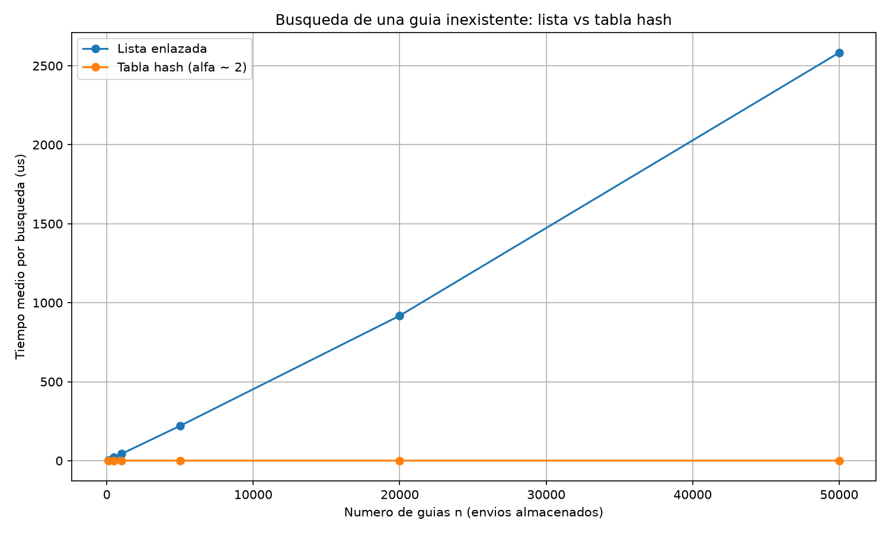
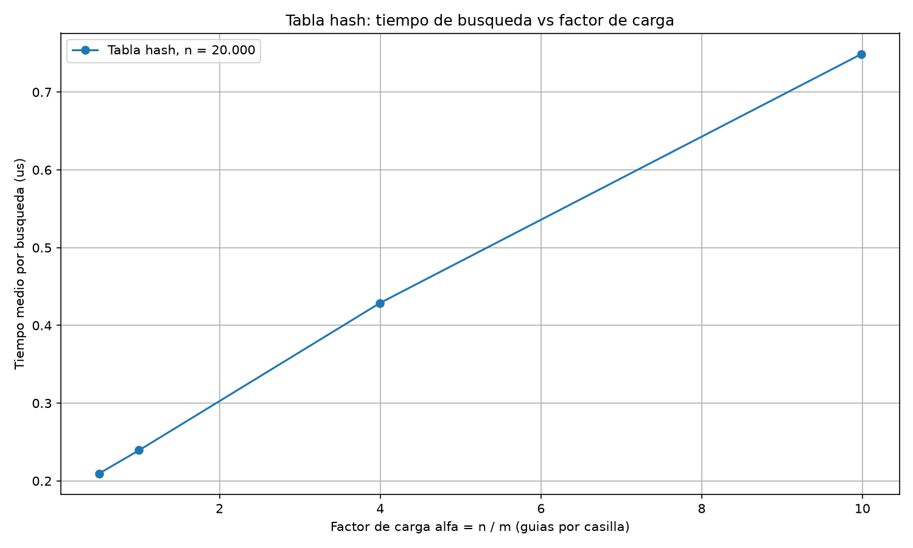

# Laboratorio evaluativo 03 — Estructuras de datos

**Estudiante:** Wilmar Fonseca García

## Reproducción del laboratorio

Todos los comandos se ejecutan desde la raíz del repositorio.

### Activar el entorno virtual

En Windows:

```bash
.venv\Scripts\activate
```

En macOS o Linux:

```bash
source .venv/bin/activate
```

Si falta `matplotlib`:

```bash
pip install -r requirements.txt
```

### Ejecutar las pruebas

```bash
python laboratorios/lab3-estructuras-datos/pruebas.py
```

Si todo está bien, imprime `Todas las pruebas pasaron correctamente.`

### Ejecutar la medición y generar las gráficas

```bash
python laboratorios/lab3-estructuras-datos/medicion.py
```

Imprime las tablas de resultados de los dos experimentos y los factores de
crecimiento entre valores consecutivos de `n`, y genera
`graficas/lista_vs_tabla.png` y `graficas/tiempo_vs_alfa.png`. Tarda menos de
un minuto.

---

# Parte 1 — Implementar y verificar las dos estructuras

Código: [`estructuras.py`](estructuras.py) y [`pruebas.py`](pruebas.py)

Se implementaron `Nodo`, `ListaEnlazada` (inserción al inicio en Θ(1) y
búsqueda iterativa con `while`) y `TablaHash` (encadenamiento, con una
`ListaEnlazada` por casilla y función hash por división, `guia % m`). La tabla
no usa `dict`, `set` ni la función `hash()` de Python, y la búsqueda recorre
solo la lista de la casilla calculada.

La verificación está en `pruebas.py`, que se ejecuta con `assert` y cubre:

- búsquedas exitosas e infructuosas en la lista y en la tabla, con la serie de
  ejemplo del enunciado y con estructuras vacías;
- la colisión forzada con `m = 7`: las guías 10, 24 y 17 caen en la casilla 3,
  las tres se insertan y se encuentran después, y la lista de esa casilla tiene
  longitud 3;
- `factor_carga()` igual a 3 / 7 tras esas tres inserciones;
- 30 colecciones aleatorias (semilla fija, distintos `n` y `m`) en las que la
  lista y la tabla devuelven lo mismo para guías existentes y para guías
  inexistentes.

---

# Parte 2 — Medir y graficar

Código: [`medicion.py`](medicion.py)

**Cómo se midió.** Las guías son enteros distintos de diez dígitos generados con
semilla fija, y se usan las mismas guías en la lista y en la tabla. El
cronómetro (`time.perf_counter()`) rodea solo las búsquedas, nunca la
construcción de las estructuras ni la generación de datos. Cada medición repite
el bloque de búsquedas 7 veces y se reporta la **mediana** del tiempo medio por
búsqueda, que resiste mejor el ruido del sistema. Dentro del propio experimento
se verifica que, para una muestra de guías existentes, la lista y la tabla
devuelven el mismo estado.

**Experimento A.** Para cada `n` se hacen 200 búsquedas de guías inexistentes
(con `generar_guias_inexistentes`) y la tabla usa `m` primo cercano a `n / 2`,
de modo que `α ≈ 2`. Se midieron 6 valores de `n`: 100, 500, 1.000, 5.000, 20.000 y 50.000.



Tiempos medidos (mediana de 7 repeticiones; 200 búsquedas de guías
inexistentes por medición):

| n | m | alfa | Lista (us) | Tabla (us) |
|---:|---:|---:|---:|---:|
| 100 | 53 | 1.89 | 4.261 | 0.246 |
| 500 | 251 | 1.99 | 21.798 | 0.249 |
| 1000 | 503 | 1.99 | 42.693 | 0.286 |
| 5000 | 2503 | 2.00 | 220.179 | 0.297 |
| 20000 | 10007 | 2.00 | 917.710 | 0.278 |
| 50000 | 25013 | 2.00 | 2582.808 | 0.263 |

Factor por el que se multiplica el tiempo entre valores consecutivos de `n`
(esperado: lista = n₂ / n₁, tabla = 1):

| n1 -> n2 | n2 / n1 | Lista medido | Tabla medido |
|---|---:|---:|---:|
| 100 -> 500 | 5.00 | 5.12 | 1.01 |
| 500 -> 1000 | 2.00 | 1.96 | 1.15 |
| 1000 -> 5000 | 5.00 | 5.16 | 1.04 |
| 5000 -> 20000 | 4.00 | 4.17 | 0.94 |
| 20000 -> 50000 | 2.50 | 2.81 | 0.95 |

**Experimento B.** Con `n = 20.000` guías fijas se construyen tablas con 4
valores de `α` (0,5; 1; 4 y 10) (con `m` primo cercano a `n / α`) y se miden
1.000 búsquedas de guías inexistentes en cada una.



Tiempos medidos con `n = 20.000` (mediana de 7 repeticiones; 1.000
búsquedas de guías inexistentes por medición):

| alfa | Tabla (us) |
|---:|---:|
| 0.50 | 0.209 |
| 1.00 | 0.239 |
| 4.00 | 0.429 |
| 9.99 | 0.749 |

---

# Parte 3 — Análisis

## 1. Costo teórico

Buscar una guía que no existe en la lista cuesta Θ(n) porque toca revisar uno por uno todos los nodos hasta el final. En la tabla, primero se aplica la función hash para calcular la casilla (costo 1) y después se recorre la lista de esa casilla, que en promedio tiene n/m nodos, o sea α = n/m. Por eso el costo en promedio queda en Θ(1 + α). Esto se cumple bajo el supuesto de hash uniforme, lo que significa que cada guía tiene la misma probabilidad de caer en cualquiera de las m casillas. Si todas las guías cayeran en el mismo lugar, se armaría una sola fila larguísima con los n elementos y la tabla rendiría igual que una lista lineal de Θ(n).

## 2. Lo medido contra lo esperado

En la primera gráfica, la lista llega a unos 918 µs con n = 20.000, mientras que la tabla se mantiene en 0,278 µs. Al pasar de n = 5.000 a n = 20.000, el tiempo de la lista se multiplicó por 4,17 (esperado 4 si es Θ(n)) y el de la tabla por 0,94 (esperado 1 si es Θ(1)); coincide porque el crecimiento de la lista es lineal y el de la tabla es prácticamente constante. En la segunda gráfica, cuando α pasa de 0,5 a 10, el tiempo pasa de 0,209 a 0,749 µs. Esto es coherente con Θ(1 + α) porque al aumentar el factor de carga, las cadenas se alargan y el recorrido interno empieza a pesar un poco más; α se multiplicó por 20 pero el tiempo solo por unas 3,6 veces, porque el 1 de Θ(1 + α) es un costo fijo que no cambia.

## 3. Colisiones

Una colisión ocurre cuando dos guías distintas terminan asignadas a la misma casilla por la función hash. Pasa aunque haya más casillas que guías porque el universo de entradas posibles es gigantesco (hay unas 9.000 millones de guías posibles de diez dígitos y la tabla solo tiene m casillas) y, por pura probabilidad, a varias les toca la misma posición. Por ejemplo, con m = 7, las guías 10, 24 y 17 dan residuo 3 al aplicar el módulo, por lo que las tres caen amontonadas en la casilla 3. El encadenamiento la resuelve guardando una lista enlazada en cada posición para acomodar a todos los que caigan ahí; su ventaja es que la tabla nunca se llena y su costo es la memoria extra de los punteros y el tiempo de recorrer la lista. El direccionamiento abierto la resuelve buscando otra casilla libre dentro del mismo arreglo usando una regla de sondeo cuando la original está ocupada; su ventaja es que no requiere punteros y todo queda contiguo y su costo es que no puede superar un factor de carga de 1 y su rendimiento se degrada rápido a medida que se va llenando.

## 4. Tabla hash o árbol de búsqueda

La tabla hash no sirve para rangos porque al aplicar la función hash las claves quedan esparcidas sin orden, lo que obligaría a revisar toda la estructura para encontrar las que caen dentro del intervalo. Un árbol de búsqueda binario sí porque mantiene las llaves organizadas de manera que los menores van a la izquierda y los mayores a la derecha, permitiendo resolver búsquedas por rango con un costo de Θ(h + k), donde k es la cantidad de resultados encontrados. Si las 400.000 guías llegaran ordenadas, cada una sería mayor que la anterior y se iría colgando siempre hacia la derecha, así que el árbol queda como una simple hilera o lista lineal con altura h = 399.999 y unas 80.000 millones (8 × 10¹⁰) comparaciones en total al insertarlas una a una. Un árbol equilibrado tendría altura de unos 19 niveles y unas 7.443.856 comparaciones, es decir, más de 10.000 veces menos.

## 5. Concepto para la jefa de operaciones

Recomiendo una tabla hash para agilizar las consultas puntuales del call center y un árbol de búsqueda equilibrado (como un AVL o Rojinegro) para gestionar las consultas por rango del supervisor, porque ninguna cubre sola ambas necesidades. Estimación para 5.000.000 de envíos (no es una medición): la lista cuesta Θ(n), así que su tiempo crece en proporción a n; con un costo por nodo de unos 0,047 µs (promedio de n = 5.000, 20.000 y 50.000), una búsqueda inexistente tardaría unos 236 ms (0,24 segundos). La tabla, con α fijo, cuesta Θ(1 + α) y no depende de n, así que se mantiene en unos 0,28 µs. No es una regla de tres directa sobre el tiempo total, sino una extrapolación basada en el comportamiento teórico lineal (Θ(n)) del costo unitario por nodo; la forma lineal se apoya en mi primera gráfica, donde la lista crece en línea recta y sus factores medidos coinciden con n₂/n₁ (por ejemplo 4,17 frente a 4,00 entre n = 5.000 y n = 20.000). El tiempo real podría ser mayor al estimado porque al saltar a 5.000.000 de elementos los datos ya no caben en la memoria caché del procesador.
